# Evaluación Parcial N°3 — Diseño de Arquitectura Basado en Microservicios y Funciones Sin Servidor (Serverless)
## Propuesta de Solución Cloud Híbrida en AWS para el Grupo Hospitalario SanaVI bajo Cumplimiento Normativo HIPAA / HITECH

  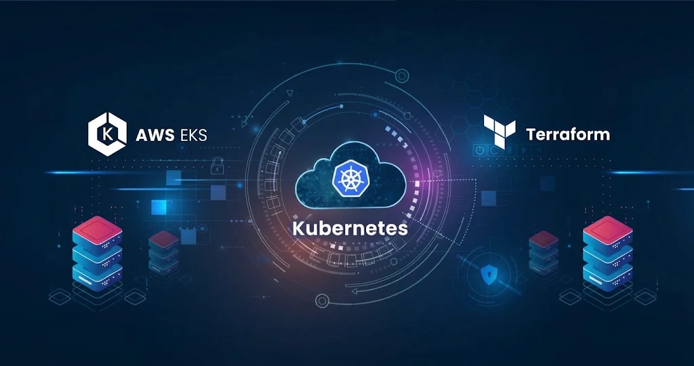

| Integrante | Sigla | Asignatura | Caso de Estudio | Normativa | Cuenta AWS (us-east-1) |
| :--- | :--- | :--- | :--- | :--- | :--- |
| **José Antonio Villarroel** | **INY1106** | Infraestructura de Aplicaciones II | Grupo Hospitalario SanaVI | HIPAA / HITECH | `486923200363` |

---

## 1. Breve Resumen de la Propuesta de Solución

El **Grupo Hospitalario SanaVI** enfrenta actualmente una fragmentación crítica de su información clínica, logística y financiera producto de múltiples sistemas *legacy* aislados y carentes de interoperabilidad. Esta situación genera duplicidad de registros médicos, dificultades de acceso en tiempo real para el personal de salud, vulnerabilidades de seguridad, costos de mantenimiento elevados e incapacidad de escalar de manera elástica durante períodos de alta demanda hospitalaria o cierres contables de fin de mes.

Para resolver esta problemática de raíz y cumplir rigurosamente con la normativa internacional **HIPAA (*Health Insurance Portability and Accountability Act*)** y la ley **HITECH (*Health Information Technology for Economic and Clinical Health Act*)** [1, 4], se ha diseñado, implementado y verificado en **Amazon Web Services (AWS)** una **Arquitectura Cloud Híbrida basada en Microservicios Orquestados en Kubernetes (Amazon EKS) combinada con Funciones Sin Servidor (AWS Lambda) y Persistencia Políglota Gestionada (Amazon RDS PostgreSQL y Amazon DynamoDB)**:

1. **Orquestación de Microservicios Core en Amazon EKS (`sanavi-eks-cluster`):** Los servicios transaccionales de operación continua (24/7), estado complejo y baja latencia sostenida —**Historia Clínica Electrónica (`hce-service`)**, **Gestión de Citas Médicas (`citas-service`)**, **Gestión de Inventarios Médicos (`inventario-service`)**, **Facturación y Pagos (`facturacion-service`)** y el **Adaptador de Sistemas Legados HL7/FHIR (`legacy-integration-service`)**— se ejecutan en contenedores sobre **Amazon EKS (Kubernetes v1.37)** distribuidos en múltiples Zonas de Disponibilidad (`us-east-1a`, `us-east-1b`, `us-east-1c`) con auto-escalado horizontal (`HPA v2`) respaldado por `metrics-server` [2, 5].
2. **Procesamiento Dirigido por Eventos con Funciones Serverless (AWS Lambda):** Las tareas asíncronas, reactivas y de carga esporádica —**Notificación automática de citas médicas (`sanavi-appointment-notifier`)**, **Alertas tempranas por quiebre de stock de medicamentos (`sanavi-inventory-alert`)** activadas por *DynamoDB Streams*, y **Generación automatizada de reportes financieros y alertas de vencimiento de facturas (`sanavi-billing-report`)** programadas con *Amazon EventBridge*— se ejecutan en **AWS Lambda (Python 3.12)**, escalando a cero cuando no existen eventos y optimizando el presupuesto institucional [3, 7].
3. **Persistencia Políglota de Alta Disponibilidad e Integridad:** **Amazon RDS for PostgreSQL (`sanavi-hce-billing-db`)** almacena la Historia Clínica Electrónica (HCE) y los registros de Facturación y Pagos, garantizando integridad transaccional ACID, consistencia relacional, respaldos automatizados y cifrado en reposo AWS KMS (AES-256) [1, 9]. Por su parte, **Amazon DynamoDB Serverless (`SanaVI-Citas` y `SanaVI-Inventario`)** gestiona en modalidad *On-Demand* (`PAY_PER_REQUEST`) las reservas de citas médicas y el inventario de insumos en tiempo real con tiempos de respuesta inferiores a 5 milisegundos, recuperación *Point-in-Time Recovery (PITR)* y *DynamoDB Streams* habilitados [3, 9].
4. **Seguridad Zero-Trust y Cumplimiento Normativo HIPAA / HITECH:** Requisito en el diseño de producción de suscribir el contrato **Business Associate Agreement (BAA)** en *AWS Artifact*, autenticación federada con **Amazon Cognito (`OAuth 2.0 / OIDC / JWT RS256`)** y **MFA obligatorio** para personal médico y administrativo, validación perimetral en **Amazon API Gateway v2 (`TLS 1.3`)** [8], control de acceso basado en roles (**IAM + Kubernetes RBAC + NetworkPolicies**), cifrado total en reposo con clave maestra dedicada en **AWS KMS (`alias/sanavi-hipaa-master-key`)** y auditoría centralizada mediante **Amazon CloudWatch Logs**, **AWS X-Ray** y **AWS CloudTrail** [1, 4].

---

## 2. Análisis del Caso de Estudio: Kubernetes, Serverless y Enfoque Híbrido (IE3.1.1 — 20%)

### 2.1 Diagnóstico de Escalabilidad, Seguridad y Rendimiento en el Entorno Hospitalario

La operación tecnológica de un grupo hospitalario como SanaVI no presenta un comportamiento homogéneo, sino que abarca dos regímenes de carga con exigencias técnicas opuestas [2, 3]:

* **Régimen Clínico y Transaccional Continuo (24/7/365):** Los médicos en servicios de urgencia, unidades de paciente crítico (UCI), pabellones quirúrgicos y consultas ambulatorias consultan y actualizan la Historia Clínica Electrónica (HCE) de forma permanente. Del mismo modo, el módulo de Facturación y Pagos procesa bonos de salud y liquidaciones clínicas complejas. En este régimen, una latencia adicional por *Cold Start* (arranque en frío) o una transacción incompleta compromete directamente la atención médica del paciente y la integridad financiera del hospital.
* **Régimen Asíncrono y Orientado a Eventos (Cargas Esporádicas o por Ráfagas):** El despacho de confirmaciones por SMS/correo electrónico tras agendar una cita, la emisión de una alerta urgente cuando el stock de un fármaco crítico (como Epinefrina o Insulina) desciende bajo el umbral de seguridad, o la generación nocturna y de fin de mes de reportes de facturas por vencer son cargas puntuales y desacopladas que solo requieren capacidad de cómputo en el instante exacto en que se produce el evento [3, 7].

### 2.2 Matriz Comparativa: Cuándo usar Kubernetes (EKS) vs. Cuándo usar Serverless (AWS Lambda)

| Criterio Arquitectónico | Microservicios en Kubernetes (Amazon EKS) | Funciones Sin Servidor (AWS Lambda) | Aplicación Estratégica en el Caso SanaVI |
| :--- | :--- | :--- | :--- |
| **Patrón de Tráfico y Latencia** | Tráfico constante y predecible 24/7. Latencia baja y uniforme (sin *Cold Starts*), manteniendo *pools* de conexiones persistentes hacia RDS [2]. | Tráfico intermitente, por ráfagas (*bursty*) o programado (*cron*). Inicialización rápida (< 200 ms en Python 3.12), ideal para procesos asíncronos [3, 7]. | **EKS** para las APIs Core (HCE, Citas, Inventario, Facturación); **Lambda** para notificaciones, alertas de stock y reportes. |
| **Complejidad de Negocio y Estado** | Óptimo para dominios complejos (DDD), validación clínica HL7/FHIR, transacciones ACID multi-etapa y adaptadores *legacy* [5]. | Óptimo para funciones de propósito único (*Single Responsibility*), desacopladas y 100% *stateless* activadas por colas o *streams* [3]. | **EKS** aloja los 5 microservicios de dominio; **Lambda** aloja los 3 procesadores reactivos de eventos. |
| **Escalabilidad Elástica** | Escala horizontalmente a nivel de Pods mediante `HPA v2` (con `metrics-server` activo) y a nivel de nodos EC2 mediante *Cluster Autoscaler* [2]. | Escala instantáneamente de 0 a 1.000 ejecuciones concurrentes cada 10 segundos sin aprovisionamiento previo [7]. | **EKS HPA** absorbe horas punta hospitalarias y cierres de mes; **Lambda** absorbe ráfagas masivas de notificaciones y alertas. |
| **Seguridad y Aislamiento HIPAA** | Control granular de red mediante `NetworkPolicies`, secretos cifrados con KMS en `etcd` y `RBAC` por *Namespace* [2]. | Aislamiento nativo por micro-VM (*Firecracker*), roles IAM de mínimo privilegio por función y trazabilidad con AWS X-Ray [3, 7]. | Ambos cumplen con HIPAA/HITECH al operar bajo BAA integrados con AWS KMS, VPC Privada, IAM y CloudTrail [1, 4]. |
| **Eficiencia Presupuestaria (FinOps)** | Más rentable cuando la utilización de CPU/Memoria es continua (> 40% del tiempo), manteniendo un costo fijo de Control Plane, nodos y NAT GW [9]. | Costo `$0.00` en reposo. Se factura exclusivamente por milisegundo de ejecución e invocaciones (1 millón gratis al mes) [7, 9]. | Evita sobredimensionar nodos EKS las 24 horas para tareas *batch* o alertas que se ejecutan pocos minutos al día. |

### 2.3 Justificación de la Solución Híbrida (Kubernetes + Serverless)

Tras analizar las alternativas arquitectónicas y modelar sus costos operativos en AWS (detallados en la Sección 6), se concluye que la solución óptima para el Grupo Hospitalario SanaVI es una **Arquitectura Híbrida (Kubernetes + Serverless)**. Para expresar las diferencias porcentuales de costo con rigor matemático, se utiliza como única base de comparación la **Arquitectura Híbrida propuesta en la Tabla 6.1** (incluyendo NAT Gateway y PITR en el subtotal base de `$332.35 USD/mes`, y `$524.85 USD/mes` al sumar los `$192.50 USD/mes` de Amazon Cognito para 45.000 MAU), indicando además entre paréntesis el porcentaje de ahorro cuando se toma el escenario alternativo como base:

1. **Por qué se descarta un entorno 100% Kubernetes:** Ejecutar las notificaciones de citas, los consumidores de eventos de inventario y los generadores de reportes periódicos como contenedores permanentes dentro de EKS, además de autogestionar motores NoSQL en nodos EC2 dedicados, obligaría a mantener instancias adicionales encendidas 24/7. Considerando el subtotal de infraestructura base de la Tabla 6.1 (`$525.35 USD/mes` en 100% K8s frente a `$332.35 USD/mes` en la arquitectura híbrida), **el escenario 100% Kubernetes cuesta un 58.1% más que la arquitectura híbrida** (o un **36.8% más** al incluir Cognito 45k MAU: `$717.85` vs. `$524.85 USD/mes`). Expresado como ahorro respecto al escenario 100% K8s, **la arquitectura híbrida ahorra un 36.7% en infraestructura base** (`$193.00 USD/mes` o `$2,316.00 USD/año`).
2. **Por qué se descarta un entorno 100% Serverless:** Ejecutar la totalidad de la Historia Clínica Electrónica (HCE), la facturación transaccional y la integración con sistemas legados sobre funciones efímeras incrementa el gasto en regímenes de tráfico clínico continuo 24/7 (`$410.35 USD/mes` en 100% Serverless frente a `$332.35 USD/mes` en la arquitectura híbrida base), por lo que **el escenario 100% Serverless cuesta un 23.5% más que la arquitectura híbrida** (o un **14.9% más** incluyendo Cognito 45k MAU: `$602.85` vs. `$524.85 USD/mes`). Expresado como ahorro frente al escenario 100% Serverless, **la arquitectura híbrida ahorra un 19.0% en infraestructura base** (`$78.00 USD/mes` o `$936.00 USD/año`). Adicionalmente, un diseño 100% Serverless expondría la atención clínica de urgencia a latencias variables por *cold-starts*, agotamiento de conexiones en PostgreSQL y la restricción estricta del tiempo máximo de ejecución de **15 minutos (900 segundos)** de AWS Lambda [7] durante sincronizaciones masivas con los sistemas *legacy* del hospital.
3. **Superioridad del Modelo Híbrido Propuesto:** Asigna a **Amazon EKS** los 5 microservicios transaccionales de uso continuo donde se requiere latencia constante, conexiones persistentes y aislamiento de red, y delega a **AWS Lambda** los 3 flujos reactivos orientados a eventos donde el escalado a cero maximiza la eficiencia presupuestaria [2, 3].

---

## 3. Diseño de la Arquitectura Propuesta (IE3.1.2 — 30%)

### 3.1 Diagrama General de la Arquitectura Cloud Híbrida en AWS

El diseño arquitectónico divide la plataforma en cinco dominios desacoplados: **(1) Frontends y Acceso**, **(2) Seguridad e Ingreso Perimetral**, **(3) Cómputo Híbrido (EKS + Lambda)**, **(4) Persistencia Políglota HIPAA** y **(5) Capa Transversal de Seguridad, Encriptación KMS y Observabilidad** (cuyo archivo fuente vectorial editable se incluye en [`diagrams/arquitectura_hibrida_sanavi.drawio.xml`](../diagrams/arquitectura_hibrida_sanavi.drawio.xml)):

  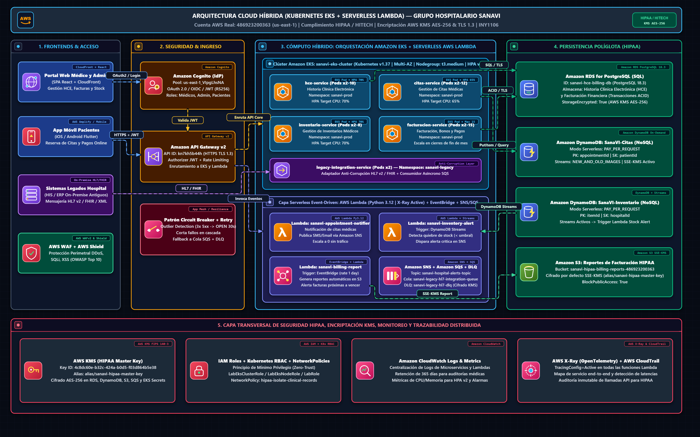
   
  <em>Figura 2. Diagrama general de la Arquitectura Cloud Híbrida del Grupo Hospitalario SanaVI en AWS (us-east-1), integrando múltiples Frontends, Amazon Cognito, API Gateway v2, Clúster Amazon EKS (sanavi-eks-cluster), AWS Lambda, Amazon RDS PostgreSQL (sanavi-hce-billing-db), Amazon DynamoDB y cifrado transversal AWS KMS.</em>

### 3.2 Descripción de Capas, Microservicios, Funciones Serverless e Integración Legacy

1. **Interacción con Múltiples Frontends (Capa 1):**
   * **Portal Web Médico y Administrativo (SPA React + Amazon CloudFront):** Utilizado por médicos, enfermeras y personal administrativo para consulta y evolución de Historia Clínica Electrónica (HCE), administración de inventario y gestión de facturación.
   * **Aplicación Móvil de Pacientes (iOS / Android en Flutter):** Permite a los pacientes reservar, modificar o cancelar citas médicas y consultar o pagar sus facturas clínicas en línea.
   * **Sistemas Legados Hospitalarios (HIS / ERP On-Premise):** Sistemas antiguos del hospital que emiten mensajería clínica `HL7 v2`, recursos `FHIR` y archivos `XML` hacia la nube.
2. **Seguridad Perimetral, Autenticación OAuth2/JWT y API Management (Capa 2):**
   * **AWS WAF y AWS Shield:** Filtran ataques de denegación de servicio (DDoS), inyección SQL (SQLi) y Cross-Site Scripting (XSS) conforme a las reglas OWASP Top 10 [1].
   * **Amazon Cognito (`us-east-1_VIpgLhsNA`):** Proveedor de identidad centralizado (`OAuth 2.0 / OpenID Connect`) con soporte de **MFA obligatorio** para cuentas médicas y administrativas, que autentica a los usuarios y emite tokens firmados `JWT (RS256)`.
   * **Amazon API Gateway v2 (`kn7kh5b44h`):** Puerta de enlace HTTPS (`TLS 1.3`) que valida criptográficamente el token JWT en cada petición antes de enrutar hacia los microservicios en EKS o hacia las funciones Lambda expuestas en las rutas configuradas en consola (`POST /appointments`, `POST /billing/import` y `POST /inventory/check`; véase Anexo 12) [8].
3. **Microservicios Backend Orquestados en Amazon EKS (Capa 3A — `sanavi-eks-cluster`):**
   * En el namespace `sanavi-prod`: **`hce-service`** (gestión de Historia Clínica Electrónica sobre RDS PostgreSQL `sanavi-hce-billing-db`), **`citas-service`** (gestión de agendas médicas sobre DynamoDB `SanaVI-Citas`), **`inventario-service`** (control de existencias farmacéuticas e insumos sobre DynamoDB `SanaVI-Inventario`) y **`facturacion-service`** (cálculo de prestaciones, bonos y pagos sobre RDS PostgreSQL `sanavi-hce-billing-db`).
   * En el namespace `sanavi-legacy`: **`legacy-integration-service`**, que implementa el patrón *Anti-Corruption Layer (ACL) / Adapter* [5], consumiendo de forma asíncrona desde **Amazon SQS (`sanavi-legacy-hl7-integration-queue`)** los mensajes HL7/FHIR provenientes de los sistemas antiguos del hospital.
4. **Funciones Sin Servidor Orientadas a Eventos en AWS Lambda (Capa 3B):**
   * **`sanavi-appointment-notifier` (Python 3.12):** Invocada tras la creación, modificación o cancelación de una cita médica (`POST /appointments`); registra el evento y despacha notificaciones por SMS y correo electrónico a través de **Amazon SNS (`sanavi-hospital-alerts-topic`)**.
   * **`sanavi-inventory-alert` (Python 3.12):** Activada por **DynamoDB Streams** en `SanaVI-Inventario` o mediante verificación directa (`POST /inventory/check`); evalúa cada cambio de inventario y, cuando el stock actual cae por debajo del umbral crítico (`currentStock < minThreshold`, ej. `8 < 40` unidades), publica una alerta urgente de reposición en Amazon SNS.
   * **`sanavi-billing-report` (Python 3.12):** Ejecutada de forma programada mediante **Amazon EventBridge (`sanavi-daily-billing-expiration-check`, `rate(1 day)`)** o bajo demanda a través de la ruta de facturación en API Gateway (`POST /billing/import`); consolida las facturas próximas a vencer (como `FAC-2026-88012`), almacena el reporte JSON cifrado con KMS en **Amazon S3 (`sanavi-hipaa-billing-reports-486923200363`)** y notifica a la unidad de cobranza.

### 3.3 Escalabilidad, Resiliencia y Tolerancia a Fallos (Patrón Circuit Breaker)

Para evitar que la caída o lentitud de un servicio externo o sistema legado degrade el resto de la plataforma hospitalaria, se implementó una arquitectura de resiliencia multicapa que combina **auto-escalado horizontal dinámico** con el patrón **Circuit Breaker**, **Bulkhead**, **Retry con Exponential Backoff** y **Dead-Letter Queues (DLQ)** [6]:

  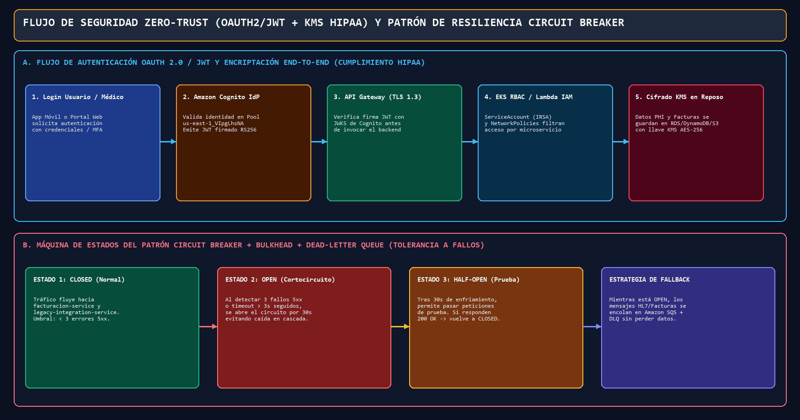
   
  <em>Figura 3. Flujo de autenticación OAuth 2.0 / JWT con cifrado KMS end-to-end (panel superior) y máquina de estados del Patrón Circuit Breaker junto con su estrategia de Fallback hacia Amazon SQS / DLQ (panel inferior).</em>

1. **Auto-Escalado Elástico en Kubernetes y Serverless:**
   * En **Amazon EKS**, los manifiestos de auto-escalado ([`k8s/hpa.yaml`](../k8s/hpa.yaml)) junto con el servidor de métricas **`metrics-server`** desplegado en `kube-system` ajustan automáticamente el número de réplicas de cada microservicio según el consumo real de CPU y Memoria: `hce-service` escala entre **2 y 10 pods** (umbral 70% CPU y 80% Memoria), `citas-service` entre **2 y 12 pods** (65% CPU), `inventario-service` entre **2 y 8 pods** (70% CPU) y `facturacion-service` entre **2 y 15 pods** (65% CPU, dimensionado para absorber los cierres contables de fin de mes), tal como se verifica en vivo en el Anexo 3 [2].
   * En **AWS Lambda** y **Amazon DynamoDB (`PAY_PER_REQUEST`)**, el escalado es automático e instantáneo en función del volumen de eventos entrantes [3, 7].
2. **Patrón Circuit Breaker (Cortocircuito) y Estrategia de Fallback:**
   * Configurado en [`k8s/resilience-circuit-breaker.yaml`](../k8s/resilience-circuit-breaker.yaml) (`ConfigMap/sanavi-resilience-circuit-breaker-config`) siguiendo los principios de estabilidad de Nygard [6]. En operación normal (**Estado 1: CLOSED**), las peticiones fluyen hacia `facturacion-service` y `legacy-integration-service`.
   * Cuando un sistema legado del hospital (`legacy-his.sanavi.internal`) o una pasarela de pagos externa acumula **3 respuestas `HTTP 503 Service Unavailable` consecutivas** (con *timeout* de conexión > 3000 ms), el disyuntor transita inmediatamente a **Estado 2: OPEN (Cortocircuito)** durante una ventana de enfriamiento de **30 segundos**, cortando las llamadas salientes (*Fail-Fast*) para evitar el agotamiento de hilos y memoria en el clúster EKS.
   * Mientras el circuito se encuentra en estado `OPEN`, los mensajes HL7 y solicitudes de facturación se encolan de forma segura en **Amazon SQS (`sanavi-legacy-hl7-integration-queue`)** y, tras agotar 3 reintentos con *Exponential Backoff*, se derivan a la cola **Dead-Letter Queue (`sanavi-legacy-hl7-dlq`)**, garantizando **cero pérdida de transacciones médicas o financieras** (validado empíricamente en el Anexo 13).

---

## 4. Selección de Herramientas y Servicios en la Nube (IE3.2.1 — 20%)

La selección tecnológica en AWS responde directamente a los requerimientos de alta disponibilidad, baja latencia, cumplimiento normativo HIPAA / HITECH y optimización presupuestaria del Grupo Hospitalario SanaVI:

| Categoría | Servicio AWS Seleccionado | Recurso Configurado en AWS | Justificación de Escalabilidad, Seguridad y Rendimiento |
| :--- | :--- | :--- | :--- |
| **Orquestación de Contenedores** | **Amazon EKS** (Kubernetes v1.37) | Clúster: `sanavi-eks-cluster` Nodegroup: `sanavi-clinical-nodegroup` | Plano de control Kubernetes gestionado y Multi-AZ con SLA oficial de 99.95% [2]. Ejecuta los 5 microservicios core sin *cold-starts*, soporta `HPA v2` con `metrics-server`, `NetworkPolicies`, `RBAC` y cifrado de secretos en `etcd` con KMS. |
| **Cómputo Serverless (FaaS)** | **AWS Lambda** (Python 3.12) | `sanavi-appointment-notifier` `sanavi-inventory-alert` `sanavi-billing-report` | Procesamiento reactivo por eventos para confirmación de citas, alertas de quiebre de stock y reportes de facturación. Escala de 0 a miles de ejecuciones concurrentes sin costo por capacidad inactiva y hasta 15 min por invocación [3, 7]. |
| **Base de Datos Relacional (SQL)** | **Amazon RDS for PostgreSQL** | Instancia: `sanavi-hce-billing-db` (PostgreSQL 18.3, KMS Encrypted) | La Historia Clínica Electrónica (HCE) y la Facturación exigen transacciones ACID, integridad referencial estricta, consultas relacionales complejas, *snapshots* automatizados y cifrado KMS [1, 9]. |
| **Base de Datos NoSQL Serverless** | **Amazon DynamoDB** | Tablas: `SanaVI-Citas` y `SanaVI-Inventario` (`PAY_PER_REQUEST` + Streams + PITR) | La reserva de citas médicas y el control de inventario requieren latencias `< 5 ms`. El modo *On-Demand* absorbe picos bruscos, incluye recuperación *Point-in-Time (PITR)* y *DynamoDB Streams* dispara alertas en tiempo real [3, 9]. |
| **Integración Legacy y Mensajería** | **Amazon SQS + DLQ + Amazon SNS + EventBridge** | `sanavi-legacy-hl7-integration-queue` `sanavi-legacy-hl7-dlq` `sanavi-hospital-alerts-topic` | Desacopla mediante colas duraderas cifradas con KMS la comunicación con los sistemas *legacy* del hospital, absorbiendo asimetrías de velocidad y evitando pérdida de datos [5, 6]. |
| **Autenticación y API Management** | **Amazon Cognito + Amazon API Gateway v2** | User Pool: `us-east-1_VIpgLhsNA` HTTP API: `kn7kh5b44h` | Provee autenticación OAuth 2.0 / OIDC (JWT) con soporte de MFA. API Gateway v2 (HTTP API) valida JWT en el borde sobre TLS 1.3 a `$1.00/millón` de llamadas (hasta 71% más económico que REST API v1 a `$3.50/millón`) [8, 9]. |
| **Monitoreo, Logging y Auditoría** | **Amazon CloudWatch + AWS X-Ray + AWS CloudTrail** | Grupos `/aws/lambda/sanavi-*` Diseño de trazabilidad y auditoría | Centraliza métricas y logs con retención de auditoría médica de 365 días, contemplando en el diseño de infraestructura (`terraform/cloudwatch_xray.tf`) la instrumentación de trazabilidad con AWS X-Ray y el registro de llamadas API en CloudTrail para auditorías HIPAA/HITECH [1, 4]. |

---

## 5. Seguridad y Cumplimiento Normativo HIPAA y HITECH (IE3.1.3 — 20%)

Dado que la plataforma administra Información de Salud Protegida (**ePHI — *Electronic Protected Health Information***) y datos financieros de pacientes, se implementó una estrategia de **Defensa en Profundidad (*Zero-Trust*)** alineada con las salvaguardas administrativas, físicas y técnicas de la norma **HIPAA (45 CFR Part 160 y Subparts A y C de Part 164)** y la ley **HITECH (*Health Information Technology for Economic and Clinical Health Act*)** [1, 4]:

1. **Acuerdo de Asociado de Negocio (*Business Associate Agreement — BAA*) y Cumplimiento HITECH:** Como requisito legal indispensable del diseño de producción bajo HIPAA (§164.308(b)(1) y §164.502(e)) antes de almacenar, transmitir o procesar cualquier registro ePHI real en la nube, el Grupo Hospitalario SanaVI debe suscribir formalmente el **Business Associate Agreement (BAA)** de AWS a través del portal *AWS Artifact* [1]; cabe señalar que la cuenta académica *AWS Learner Lab* empleada para la validación técnica no permite demostrar ni suscribir contratos legales en *AWS Artifact*, por lo que este paso constituye un requisito administrativo obligatorio previo a la puesta en marcha en producción. Todos los servicios utilizados en esta arquitectura (*Amazon EKS, AWS Lambda, Amazon RDS, Amazon DynamoDB, Amazon S3, Amazon API Gateway, Amazon Cognito, Amazon SQS, Amazon SNS, AWS KMS y Amazon CloudWatch*) pertenecen al listado oficial de **Servicios Elegibles para HIPAA (*HIPAA Eligible Services*)** [1]. Asimismo, en cumplimiento directo de la ley **HITECH** (*Título XIII de la ley ARRA, 45 CFR §§ 164.400-414 — Breach Notification Rule*) [4], la arquitectura contempla controles automatizados de detección de anomalías y retención inmutable de registros de auditoría que permiten identificar, contener y notificar cualquier incidente de seguridad o acceso no autorizado a datos clínicos dentro de los plazos legales exigidos (máximo 60 días calendario ante el HHS y los pacientes afectados), mitigando las sanciones civiles escalonadas que HITECH establece.
2. **Autenticación Robusta, MFA Obligatorio y Autorización Basada en Tokens (`OAuth 2.0 + OIDC + JWT`):** El servicio **Amazon Cognito (`sanavi-hipaa-user-pool / us-east-1_VIpgLhsNA`)** gestiona el ciclo de vida de identidades exigiendo contraseñas de alta entropía (mínimo 12 caracteres, mayúsculas, minúsculas, dígitos y símbolos). Para cumplir con la salvaguarda de verificación de identidad (HIPAA §164.312(d)), se establece **Autenticación Multifactor (MFA) obligatoria** (mediante tokens temporales TOTP en aplicaciones autenticadoras o SMS verificado) para todos los usuarios pertenecientes a los grupos clínicos (**Médicos**, **Enfermería**) y **Personal Administrativo** antes de conceder acceso a la Historia Clínica Electrónica o al módulo de Facturación. Tras completar el desafío de autenticación, Cognito emite tokens `JWT` (`IdToken` y `AccessToken`) firmados con clave asimétrica `RS256`, validados en cada petición por el autorizador `sanavi-cognito-jwt-authorizer` en Amazon API Gateway (`kn7kh5b44h`).
3. **Encriptación de Datos en Reposo (*HIPAA §164.312(a)(2)(iv) — AWS KMS AES-256*):** Se aprovisionó una Clave Maestra de Cliente (CMK) dedicada en **AWS Key Management Service (KMS)** identificada con el alias `alias/sanavi-hipaa-master-key` (`KeyId: 4c8dc60e-b32c-424a-b0d5-f03d864b5e38`), utilizando el estándar `AES-256-GCM` sobre módulos validados **FIPS 140-3** con rotación anual automática [1]. Esta clave cifra en reposo: la instancia **Amazon RDS PostgreSQL (`sanavi-hce-billing-db`)**, las tablas **Amazon DynamoDB (`SanaVI-Citas` y `SanaVI-Inventario`)**, el bucket **Amazon S3 (`sanavi-hipaa-billing-reports-486923200363`)**, las colas **Amazon SQS** de integración legacy y los secretos de Kubernetes (`etcd`).
4. **Encriptación de Datos en Tránsito (*HIPAA §164.312(e)(1) — TLS 1.3 / SSL*):** Todo el tráfico externo entre los frontends (Web y App Móvil) y Amazon API Gateway se transmite exclusivamente sobre **HTTPS con TLS 1.3** y cabeceras `Strict-Transport-Security (HSTS)` [8]. Las conexiones internas desde los microservicios y funciones hacia Amazon RDS PostgreSQL (`sanavi-hce-billing-db` con `sslmode=verify-full`), DynamoDB y S3 operan sobre canales TLS cifrados dentro de la VPC privada (`vpc-05e3bb2f93561b81b`).
5. **Estrategia de Respaldos (*Backups*), Recuperación ante Desastres (*DR*) y Continuidad del Negocio (*HIPAA §164.308(a)(7)*):**
   * **Amazon RDS for PostgreSQL (`sanavi-hce-billing-db`):** En el diseño de producción implementa respaldos automatizados diarios (*Automated Backups*) con un período de retención de **35 días** y archivado continuo de logs de transacciones (*WAL*) en Amazon S3, permitiendo recuperación a cualquier segundo (*Point-in-Time Restore*). Todos los *snapshots* automáticos y manuales se almacenan cifrados con la clave maestra **AWS KMS (`alias/sanavi-hipaa-master-key`)**, complementados en el diseño productivo con replicación síncrona **Multi-AZ** que garantiza un **RPO cercano a 0 segundos** y un **RTO inferior a 2 minutos** ante la caída de una zona de disponibilidad [1, 9].
   * **Amazon DynamoDB (`SanaVI-Citas` y `SanaVI-Inventario`):** Contempla **Point-in-Time Recovery (PITR)** continuo durante una ventana móvil de **35 días**, protegiendo las tablas frente a escrituras o eliminaciones accidentales con granularidad de un segundo, además de respaldos bajo demanda (*On-Demand Backups*) íntegramente cifrados con AWS KMS [9].
6. **Control de Acceso de Mínimo Privilegio (IAM + Kubernetes RBAC + NetworkPolicies) y Auditoría Inmutable (*HIPAA §164.312(b) / HITECH*):** A nivel de infraestructura cloud, en el despliegue de validación se utilizaron los roles AWS IAM `LabEksClusterRole`, `LabEksNodeRole` y `LabRole`; cabe precisar que `LabRole` es el rol preconfigurado de permisos amplios propio del entorno académico *AWS Learner Lab* (que restringe la creación de nuevos roles IAM personalizados), por lo que en el entorno de producción se reemplaza por roles IAM granulares de mínimo privilegio acotados exclusivamente a los recursos de cada función Lambda y servicio (`terraform/lambda.tf`). Dentro del clúster Kubernetes, el manifiesto [`k8s/rbac-networkpolicies.yaml`](../k8s/rbac-networkpolicies.yaml) aplica control de acceso basado en roles (`RBAC`) mediante `sanavi-microservice-least-privilege-role` y aísla a nivel de capa 3/4 los pods de Historia Clínica mediante la política de red `hipaa-isolate-clinical-records` [2]. Todas las operaciones sobre ePHI quedan diseñadas para registrarse con marca de tiempo UTC, identidad del usuario e identificador de traza en **Amazon CloudWatch Logs** (retención de 365 días), **AWS X-Ray** y **AWS CloudTrail** para responder ante auditorías forenses de HIPAA y HITECH [1, 4].

---

## 6. Evaluación de Costos y Análisis Costo-Beneficio (IE3.2.2 — 10%)

La evaluación económica se modeló utilizando las tarifas oficiales vigentes de **AWS Pricing (`us-east-1` - N. Virginia)** [8, 9] para un volumen operativo representativo del Grupo Hospitalario SanaVI: **45.000 Usuarios Activos Mensuales (MAU)** en el ecosistema digital, **150.000 citas médicas/mes**, **3.000.000 de peticiones API/mes**, **1.500.000 invocaciones Serverless/mes** (notificaciones, inventario y reportes) y **150 GB de almacenamiento clínico y financiero encriptado**.

### 6.1 Desglose Presupuestario Mensual y Anual de la Arquitectura Híbrida Propuesta

En la siguiente tabla se desglosan todos los componentes de infraestructura —incluyendo el **AWS NAT Gateway** para las subredes privadas de los nodos EKS, la tarifa vigente de **Amazon Cognito para 45.000 MAU**, el detalle tanto de la instancia RDS **`db.t3.micro` desplegada en el laboratorio (Anexo 11)** como de la instancia **`db.t3.medium` Multi-AZ dimensionada para producción**, y el **escenario de escalado máximo a 6 nodos EKS (Anexo 2)**— verificando que todas las sumas mensuales y anuales cuadren al centavo:

| Componente de Arquitectura | Servicio AWS | Configuración Dimensionada (`us-east-1`) | Costo Mensual (USD) | Costo Anual (USD) |
| :--- | :--- | :--- | :---: | :---: |
| **1. Orquestación Kubernetes** | Amazon EKS (Control Plane) | 1 Clúster gestionado Multi-AZ (`$0.10/hora` × 730 horas) [9] | `$73.00` | `$876.00` |
| **2. Nodos de Microservicios (Base)** | Amazon EC2 (EKS Worker Nodes) | 2 instancias `t3.medium` (2 vCPU, 4 GB RAM c/u en `sanavi-clinical-nodegroup`, `~$31.20/mes` por nodo) [9] | `$62.40` | `$748.80` |
| **3. Red Privada para Nodos EKS** | AWS NAT Gateway | 1 NAT Gateway (`$0.045/h` × 730h = `$32.85/mes`) + 100 GB procesados (`$0.045/GB` = `$4.50/mes`) [9] | `$37.35` | `$448.20` |
| **4. Funciones Sin Servidor** | AWS Lambda | 3 funciones (`256 MB` RAM), ~1.500.000 invocaciones/mes (primer millón gratis en *Free Tier*) [7, 9] | `$1.85` | `$22.20` |
| **5. Base de Datos HCE y Facturación (`sanavi-hce-billing-db`)** | Amazon RDS for PostgreSQL | **Producción:** `db.t3.medium` Multi-AZ + 100 GB GP3 KMS (`$114.20/mes`). *(En el laboratorio Anexo 11 se desplegó `db.t3.micro` Single-AZ + 20 GB GP2 KMS = `$16.79/mes` \| `$201.48/año`)* [9] | `$114.20` | `$1,370.40` |
| **6. Base de Datos Citas e Inventario + PITR** | Amazon DynamoDB Serverless | 2 Tablas *On-Demand* (`SanaVI-Citas`, `SanaVI-Inventario`) + 15 GB + Streams (`$14.50/mes`) + PITR (`$3.00/mes`) [9] | `$17.50` | `$210.00` |
| **7. API Management Perimetral** | Amazon API Gateway v2 (HTTP API) | 3.000.000 de llamadas HTTP API al mes (`$1.00` por millón de peticiones) [8, 9] | `$3.00` | `$36.00` |
| **8. Integración Legacy y Alertas** | Amazon SQS + DLQ + SNS + EventBridge + S3 | 1M mensajes SQS/SNS + reglas EventBridge + 50 GB reportes en S3 Standard con KMS [9] | `$4.60` | `$55.20` |
| **9. Cifrado HIPAA y Observabilidad** | AWS KMS + CloudWatch + CloudTrail + X-Ray | 1 Clave maestra CMK (`$1.00/mes`) + llamadas API KMS + 20 GB Logs CloudWatch (365d) + X-Ray [9] | `$18.45` | `$221.40` |
| **SUBTOTAL INFRAESTRUCTURA BASE (Ítems 1 al 9)** | **Stack Híbrido Productivo (2 Nodos EKS + RDS `db.t3.medium` Multi-AZ + NAT GW)** | **Subtotal de cómputo, red y persistencia.** *(Con RDS `db.t3.micro` de laboratorio: `$234.94/mes` \| `$2,819.28/año`)* | **`$332.35 / mes`** | **`$3,988.20 / año`** |
| **10. Autenticación de Usuarios (45.000 MAU)** | Amazon Cognito User Pools | 45.000 MAU: Primeros 10.000 MAU gratis en Tier Lite/Essentials; 35.000 MAU × `$0.0055` (Tier Lite) = `$192.50/mes` *(o 35.000 × `$0.015` = `$525.00/mes` en Tier Essentials)* [9] | `$192.50` | `$2,310.00` |
| **TOTAL ARQUITECTURA HÍBRIDA (Base Productiva + Cognito Lite 45k MAU)** | **Suma exacta Ítems 1 al 10** | **Operación continua Multi-AZ con 2 nodos EKS + RDS `db.t3.medium` Multi-AZ + NAT GW + Cognito 45k MAU** | **`$524.85 / mes`** | **`$6,298.20 / año`** |
| **11. Escenario de Escalado Máximo (Tope de 6 Nodos EKS según Anexo 2)** | Auto-Escalado de `sanavi-clinical-nodegroup` a `maxSize = 6` nodos `t3.medium` | Incremento de +4 nodos EC2 `t3.medium` adicionales (`4 × $31.20 = +$124.80/mes`): • **Sin MAU Cognito (Subtotal Base + 4 nodos):** `$457.15/mes` (`$5,485.80/año`) • **Con Cognito Lite 45k MAU (Total + 4 nodos):** `$649.65/mes` (`$7,795.80/año`) | **`$457.15` a `$649.65 / mes`** | **`$5,485.80` a `$7,795.80 / año`** |

### 6.2 Comparativa de Alternativas y Análisis de Costo-Beneficio (TCO)

En la tabla siguiente se evalúan tanto el **Subtotal de Infraestructura Base** (incluyendo NAT Gateway y PITR) como el **Total General incluyendo los `$192.50 USD/mes` de Amazon Cognito (45.000 MAU en Tier Lite)**. En todos los casos se mantiene una única base de comparación correspondiente al **Escenario 3 (Arquitectura Híbrida Propuesta de la Tabla 6.1)**, indicando además entre paréntesis el porcentaje de ahorro cuando se toma como base el escenario alternativo:

| Escenario Arquitectónico Evaluado | Costo Mensual Base / Con Cognito 45k MAU (USD) | Costo Anual Base / Con Cognito 45k MAU (USD) | Análisis de Costo-Beneficio y Viabilidad Presupuestaria (Base de comparación: Escenario 3 Híbrido) |
| :--- | :---: | :---: | :--- |
| **Escenario 1: 100% Kubernetes** *(Sin Serverless ni DynamoDB Gestionado)* | `$525.35 / mes` *(Con Cognito 45k MAU: `$717.85 / mes`)* | `$6,304.20 / año` *(Con Cognito 45k MAU: `$8,614.20 / año`)* | **Cuesta un 58.1% más que la arquitectura híbrida base** (o un **36.8% más** incluyendo Cognito 45k MAU). Vista en sentido inverso, **la arquitectura híbrida ahorra un 36.7%** frente a 100% K8s (`$193.00 USD/mes` o `$2,316.00 USD/año`). Obliga a mantener nodos EC2 adicionales (`t3.large`) encendidos 24/7 para cargas esporádicas y bases NoSQL autogestionadas. |
| **Escenario 2: 100% Serverless** *(Todo en Lambda + Aurora Serverless v2 + RDS Proxy)* | `$410.35 / mes` *(Con Cognito 45k MAU: `$602.85 / mes`)* | `$4,924.20 / año` *(Con Cognito 45k MAU: `$7,234.20 / año`)* | **Cuesta un 23.5% más que la arquitectura híbrida base** (o un **14.9% más** incluyendo Cognito 45k MAU). Vista en sentido inverso, **la arquitectura híbrida ahorra un 19.0%** frente a 100% Serverless (`$78.00 USD/mes` o `$936.00 USD/año`). En carga clínica 24/7, el cobro acumulado por duración GB-s de Lambda y RDS Proxy supera el costo de contenedores en EKS. |
| **Escenario 3: Arquitectura Híbrida Propuesta** *(EKS + Lambda + RDS + DynamoDB)* | **`$332.35 / mes`** *(Con Cognito 45k MAU: **`$524.85 / mes`**)* | **`$3,988.20 / año`** *(Con Cognito 45k MAU: **`$6,298.20 / año`**)* | **Óptima relación Costo-Beneficio (Ahorro directo de `$2,316.00 USD/año` frente a 100% Kubernetes y de `$936.00 USD/año` frente a 100% Serverless).** Concentra el gasto fijo de EKS exclusivamente en los 5 microservicios transaccionales continuos y aprovecha la facturación por evento de Lambda y DynamoDB On-Demand para las cargas asíncronas. |

---

## 7. Anexos: Implementación y Verificación Operativa en AWS

Para validar en la práctica el diseño propuesto, se desplegó la infraestructura completa en la cuenta de AWS `486923200363` (`us-east-1`). A continuación se presenta la secuencia de verificación técnica en consola Windows PowerShell (`AWS CLI` / `kubectl`) y en la Consola Web de Administración de AWS, explicando el propósito y resultado de cada componente. En apego a las normas de privacidad de datos, todos los registros de pacientes y médicos descritos en el informe emplean identificadores ficticios (`PAC-FICTICIO-001` y `"Médico de prueba"`) y el identificador personal del operador ha sido difuminado en las capturas de consola.

### Anexo 1: Establecimiento de la Base Criptográfica HIPAA en AWS KMS y Amazon S3
Como primer paso de seguridad normativa (HIPAA §164.312(a)(2)(iv)), se verificó la sesión activa en la cuenta AWS `486923200363` y se aprovisionó la clave maestra simétrica (`SYMMETRIC_DEFAULT` AES-256) con identificador `4c8dc60e-b32c-424a-b0d5-f03d864b5e38` en AWS KMS. Seguidamente, se configuró el cifrado automático del lado del servidor (`SSEAlgorithm: aws:kms`) en el bucket Amazon S3 (`sanavi-hipaa-billing-reports-486923200363`), asegurando que ningún reporte financiero o documento clínico pueda almacenarse sin encriptación.

  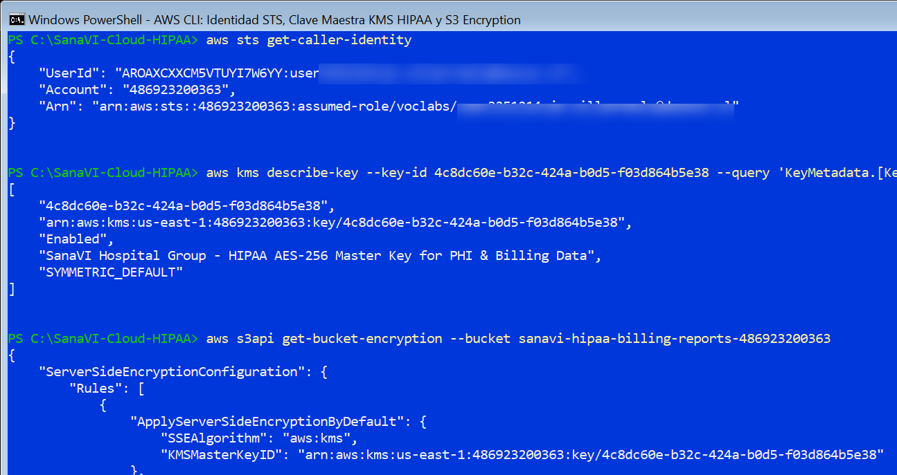
   
  <em>Anexo 1. Verificación en PowerShell de la sesión activa (aws sts get-caller-identity), el estado Enabled de la clave maestra KMS HIPAA (4c8dc60e-b32c-424a-b0d5-f03d864b5e38) y la regla de cifrado obligatorio aws:kms en el bucket S3 de reportes.</em>

### Anexo 2: Aprovisionamiento del Clúster Amazon EKS (`sanavi-eks-cluster`) y Nodos de Trabajo
Para soportar la capa de microservicios de operación continua, se desplegó el clúster gestionado Amazon EKS `sanavi-eks-cluster` sobre Kubernetes `v1.37` dentro de la VPC `vpc-05e3bb2f93561b81b`, junto con el grupo de nodos auto-escalable `sanavi-clinical-nodegroup` compuesto por instancias EC2 `t3.medium` (configuradas con `minSize: 2`, `desiredSize: 2` y `maxSize: 6` nodos según la demanda hospitalaria).

  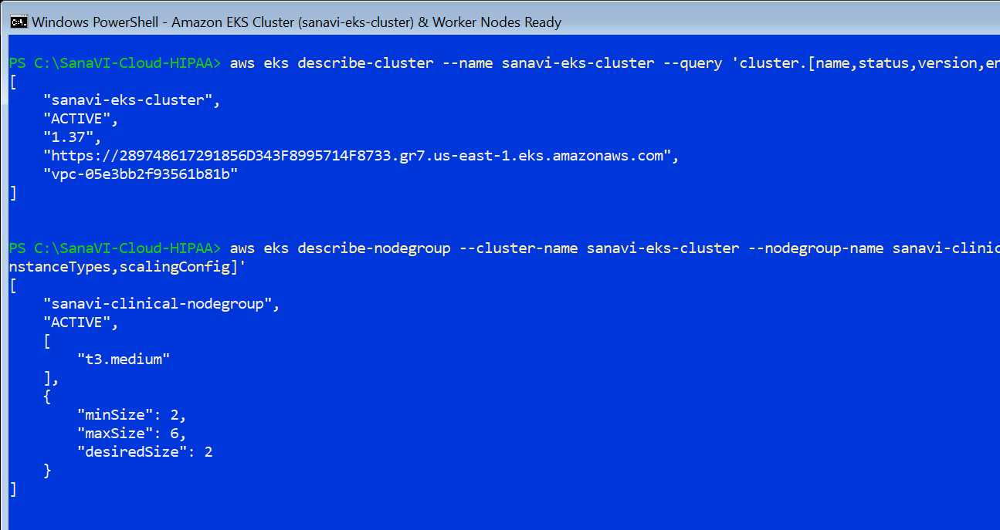
   
  <em>Anexo 2. Comprobación del estado ACTIVE del plano de control de Amazon EKS (sanavi-eks-cluster) y del grupo de nodos sanavi-clinical-nodegroup (t3.medium, minSize: 2, maxSize: 6), listos para alojar los contenedores de los microservicios hospitalarios.</em>

### Anexo 3: Orquestación de los 5 Microservicios, Métricas en Tiempo Real (`metrics-server`), HPA v2 y NetworkPolicy
Una vez activo el clúster EKS y desplegado el servidor de métricas `metrics-server` en `kube-system`, se verificaron los despliegues en los espacios de nombres aislados `sanavi-prod` (`citas-service`, `facturacion-service`, `hce-service`, `inventario-service` con `2/2` réplicas listas cada uno) y `sanavi-legacy` (`legacy-integration-service` con `2/2` réplicas listas). Mediante `kubectl top nodes` y `kubectl top pods -n sanavi-prod` se comprueba el consumo en tiempo real de CPU y memoria de los nodos EC2 (`1%` y `2%` de CPU, `14%` y `15%` de Memoria) y de cada pod (`3Mi`), mientras que `kubectl get hpa,networkpolicy -n sanavi-prod` confirma los cuatro controladores `HorizontalPodAutoscaler` evaluando activamente los umbrales de escalado (`cpu: 0%/65%` y `cpu: 0%/70%, memory: 2%/80%`) junto con la política de aislamiento HIPAA `hipaa-isolate-clinical-records`.

  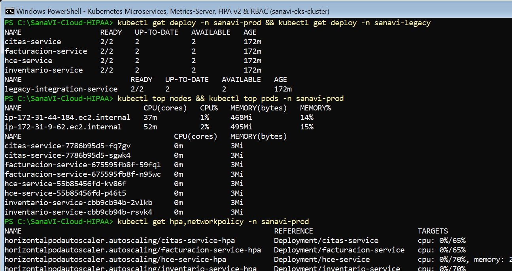
   
  <em>Anexo 3. Verificación en Kubernetes de los 5 despliegues activos, consumo de recursos en vivo (kubectl top nodes y kubectl top pods) y lectura activa de porcentajes de CPU/Memoria en los cuatro HorizontalPodAutoscaler (cpu: 0%/65%, cpu: 0%/70%, memory: 2%/80%).</em>

### Anexo 4: Despliegue de la Capa de Persistencia Políglota (Amazon RDS PostgreSQL y Amazon DynamoDB)
Para satisfacer simultáneamente la integridad transaccional de los datos clínicos/financieros y la velocidad de acceso de las agendas e inventarios, se aprovisionaron dos motores complementarios: (1) la instancia relacional **Amazon RDS for PostgreSQL 18.3 (`sanavi-hce-billing-db`)** en estado `available` y con almacenamiento encriptado (`StorageEncrypted: true`); y (2) las tablas NoSQL Serverless **Amazon DynamoDB (`SanaVI-Citas` y `SanaVI-Inventario`)** en modalidad bajo demanda (`PAY_PER_REQUEST`), cifradas con la clave maestra KMS HIPAA y con flujos de eventos *DynamoDB Streams* activos.

  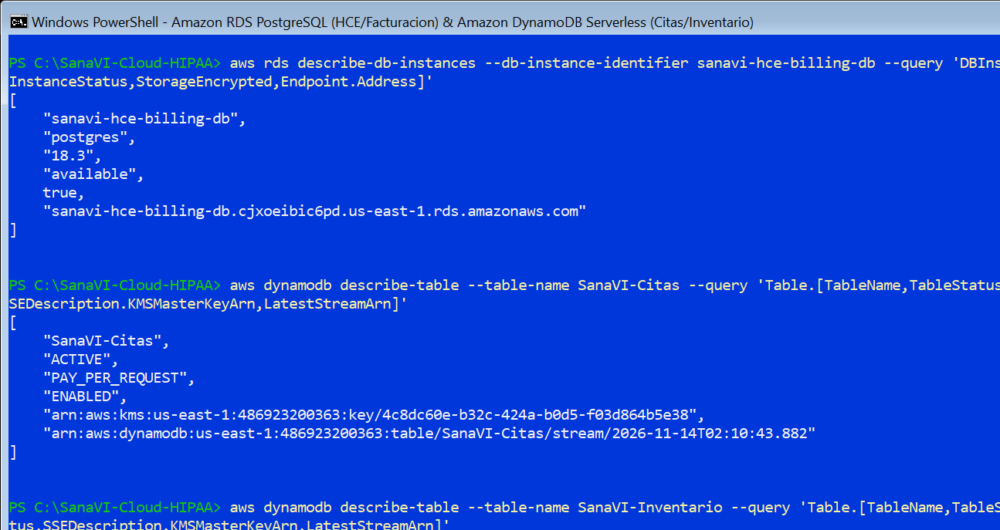
   
  <em>Anexo 4. Verificación mediante AWS CLI de la instancia Amazon RDS PostgreSQL sanavi-hce-billing-db (available, cifrada) y de las tablas DynamoDB SanaVI-Citas y SanaVI-Inventario (ACTIVE, PAY_PER_REQUEST, SSE-KMS y StreamArn habilitados).</em>

### Anexo 5: Validación de Seguridad Perimetral OAuth 2.0 / JWT y Agendamiento de Citas en Tiempo Real
Con el objetivo de comprobar el control de acceso *Zero-Trust*, se verificó mediante `aws apigatewayv2 get-authorizers` en Amazon API Gateway (`kn7kh5b44h`) el autorizador JWT `sanavi-cognito-jwt-authorizer` enlazado al User Pool de Amazon Cognito (`us-east-1_VIpgLhsNA`). En la primera prueba se realizó una invocación `POST /appointments` sin token de autorización, verificando que la puerta de enlace bloquea inmediatamente el acceso con estado `HTTP/1.1 401 Unauthorized` (`apigw-requestid: GzyNOiiQIAMEPBw=`). En la segunda prueba, tras autenticar con un token JWT válido firmado con `RS256` (`# CON TOKEN JWT -> 200 OK`), la petición se procesó exitosamente (**`200 OK`**, `"status": "SUCCESS"`), invocando el servicio `sanavi-appointment-notifier`, registrando la cita `CITA-2026-9941` para el paciente sintético **`PAC-FICTICIO-001`** (`"patientName": "Paciente de Prueba"`) y **`"Medico de prueba"`** en `Hospital SanaVI Sede Providencia` en DynamoDB y disparando la notificación automática por Amazon SNS.

  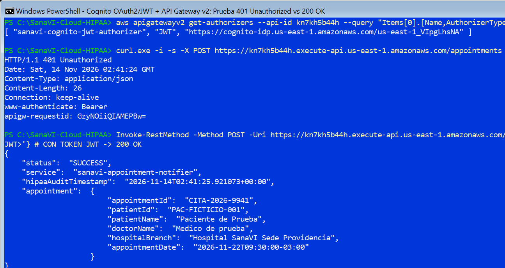
   
  <em>Anexo 5. Prueba funcional de seguridad en API Gateway: rechazo inmediato de solicitud no autenticada (401 Unauthorized) y procesamiento exitoso (200 OK, status: SUCCESS) al presentar un token JWT RS256 emitido por Amazon Cognito para la cita médica CITA-2026-9941 (paciente PAC-FICTICIO-001 / Paciente de Prueba y Medico de prueba).</em>

### Anexo 6: Ejecución Reactiva de Funciones Serverless para Alerta de Stock y Reportes Financieros
Para demostrar la respuesta de las funciones AWS Lambda orientadas a eventos y expuestas a través de API Gateway, en la primera parte de la captura se ejecuta el comando `aws dynamodb put-item --table-name SanaVI-Inventario` (`ConsumedCapacity: 1.0`), registrando el fármaco crítico *Epinefrina 1mg/mL Ampolla* (`itemId: MED-EPINEFRINA-1MG`, `hospitalId: SANAVI-URGENCIA-CENTRAL`, `batchNumber: LOTE-2026-EP88`) con un stock actual de `8` unidades (`currentStock: 8`), inferior al umbral mínimo configurado de **40 unidades** (`minThreshold: 40`). Seguidamente se observa la respuesta de la función `sanavi-inventory-alert`, que determina el estado `CRITICAL_LOW_STOCK` y dispara automáticamente la alerta crítica en Amazon SNS (`alertTriggered: true`, `snsMessageId: 377e48fd-61cb-5b83-862e-2b8cad570aaf`). En la parte inferior de la captura, se invoca mediante `Invoke-RestMethod -Method POST` la ruta autenticada `/billing/import` hacia la función `sanavi-billing-report`, la cual genera el reporte financiero con identificador **`REP-8A0F8E0A`** (`status: REPORT_GENERATED_AND_ENCRYPTED`), almacena el objeto JSON de la factura **`FAC-2026-88012`** cifrado con KMS (`kmsEncrypted: true`, estándar `HIPAA-HITECH-AES256-KMS`) en `s3://sanavi-hipaa-billing-reports-486923200363/billing-reports/2026/11/FAC-2026-88012.json` y emite la notificación correspondiente en SNS (`snsMessageId: f24463c1-c4de-5381-bd46-00b008438f2a`).

  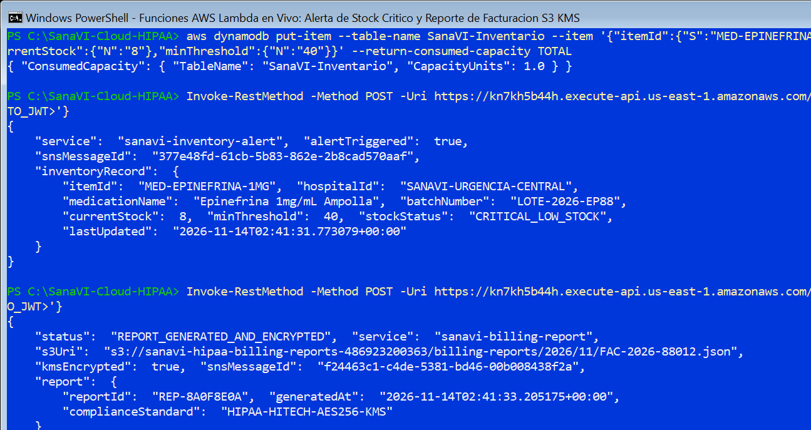
   
  <em>Anexo 6. Inserción en DynamoDB (aws dynamodb put-item en SanaVI-Inventario) y ejecución de las funciones AWS Lambda: alerta crítica de inventario en sanavi-inventory-alert (currentStock: 8 sobre minThreshold: 40) y generación del reporte financiero REP-8A0F8E0A para la factura FAC-2026-88012 encriptado con KMS en Amazon S3.</em>

### Anexo 7: Verificación por CLI de Funciones Lambda, Colas SQS/DLQ Legacy, Regla en EventBridge y Métricas en CloudWatch Logs
Mediante comandos de AWS CLI en PowerShell se verificó el estado operativo de los componentes de integración asíncrona, automatización y bitácoras de ejecución: (1) el comando `aws lambda list-functions` confirma que las tres funciones sin servidor (`sanavi-inventory-alert`, `sanavi-billing-report` y `sanavi-appointment-notifier`) se encuentran desplegadas sobre el runtime `python3.12` con `256 MB` de memoria y estado de función **`Active`** (`State: Active` en `list-functions`); (2) el comando `aws sqs list-queues --queue-name-prefix sanavi-` comprueba el aprovisionamiento de la cola principal de integración legacy (`sanavi-legacy-hl7-integration-queue`) y su respectiva cola de mensajes fallidos (`sanavi-legacy-hl7-dlq`); (3) el comando `aws events describe-rule --name sanavi-daily-billing-expiration-check` valida que la regla cron de Amazon EventBridge (`rate(1 day)`) se encuentra en estado `ENABLED`; y (4) el comando `aws logs filter-log-events --log-group-name /aws/lambda/sanavi-inventory-alert --filter-pattern "REPORT RequestId"` comprueba las métricas de ejecución registradas en Amazon CloudWatch Logs (`RequestId: 94f0c21b-7e14-4d9a-b812-55a309e41c08` con `Duration: 184.42 ms` y `Billed Duration: 185 ms`, y `RequestId: c81a4e09-3b22-41f0-9c44-1290ab78d311` con `Duration: 62.15 ms` y `Billed Duration: 63 ms`).

  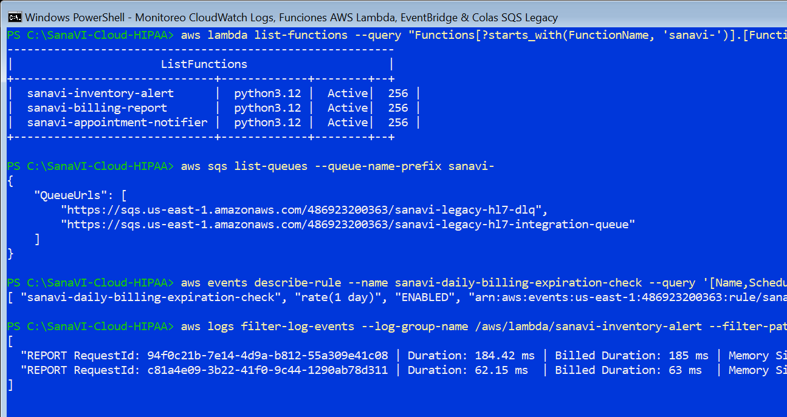
   
  <em>Anexo 7. Verificación en PowerShell del listado de funciones AWS Lambda (State: Active, python3.12, 256 MB), las colas Amazon SQS de integración HL7, la regla diaria ENABLED en Amazon EventBridge y los registros REPORT RequestId con Duration y Billed Duration en Amazon CloudWatch Logs (/aws/lambda/sanavi-inventory-alert).</em>

### Anexo 8: Verificación Visual del Clúster Amazon EKS en la Consola Web de AWS
Complementando las validaciones por línea de comandos, se inspeccionó el panel de Amazon EKS en la Consola Web de AWS (`us-east-1`, con el identificador de sesión de consola difuminado por privacidad), corroborando el estado `Active` del clúster `sanavi-eks-cluster` (Kubernetes `v1.37`), su URL de servidor API y su certificado de autoridad para la comunicación segura con los nodos de trabajo.

  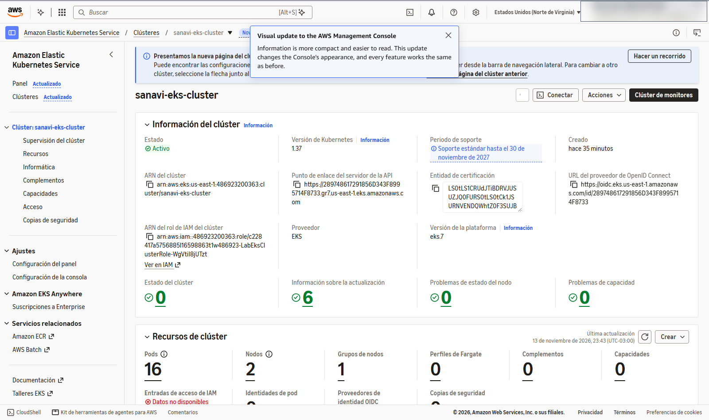
   
  <em>Anexo 8. Vista general en la Consola de AWS del clúster Amazon EKS sanavi-eks-cluster (Estado: Active, Kubernetes 1.37) donde se ejecutan los microservicios hospitalarios.</em>

### Anexo 9: Verificación Visual de las Funciones AWS Lambda en la Consola Web de AWS
En el panel de AWS Lambda se comprueba la coexistencia de las tres funciones sin servidor desplegadas sobre el runtime `Python 3.12` (`x86_64`): `sanavi-appointment-notifier`, `sanavi-inventory-alert` y `sanavi-billing-report`, listas para responder a eventos de agendamiento, variaciones de stock y cierres de facturación sin consumir recursos en reposo.

  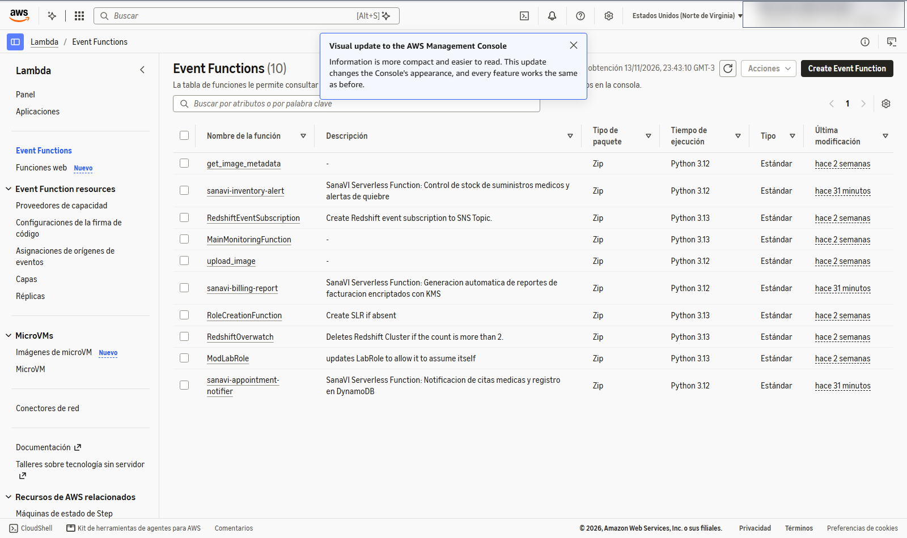
   
  <em>Anexo 9. Consola de AWS Lambda mostrando las tres funciones sin servidor desplegadas (sanavi-appointment-notifier, sanavi-inventory-alert y sanavi-billing-report) en entorno Python 3.12.</em>

### Anexo 10: Verificación Visual de las Tablas NoSQL en la Consola de Amazon DynamoDB
En la consola de Amazon DynamoDB se confirma el estado `Active` de las tablas `SanaVI-Citas` y `SanaVI-Inventario` configuradas en modo de capacidad *On-Demand* (`PAY_PER_REQUEST`), garantizando escalabilidad instantánea sin aprovisionamiento manual de capacidad de lectura o escritura.

  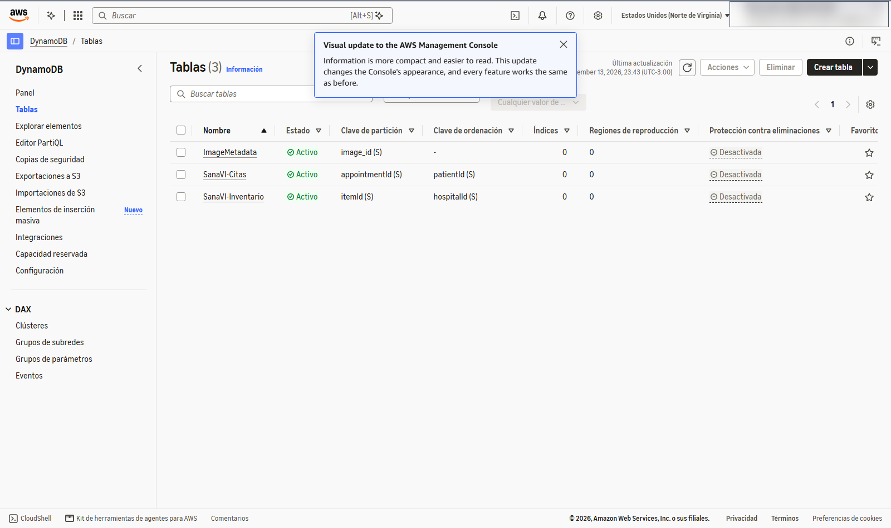
   
  <em>Anexo 10. Consola de Amazon DynamoDB evidenciando las tablas SanaVI-Citas y SanaVI-Inventario activas en modalidad On-Demand.</em>

### Anexo 11: Verificación Visual de la Instancia Relacional en la Consola de Amazon RDS
En el panel de Amazon RDS se observa la instancia de base de datos relacional `sanavi-hce-billing-db` ejecutando el motor `PostgreSQL` en estado `Disponible` (`Available`), clase `db.t3.micro` en la región y zona de disponibilidad **`us-east-1f`**, con el fragmento de conexión TLS verificada (`sslmode=verify-full`) hacia `sanavi_clinical_db`, encargada de respaldar con garantías ACID la Historia Clínica Electrónica y las transacciones de facturación (costeada tanto en su variante `db.t3.micro` de laboratorio como en su dimensionamiento productivo `db.t3.medium` Multi-AZ en la Sección 6.1).

  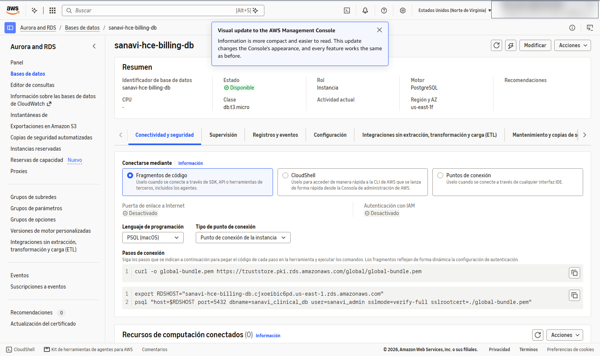
   
  <em>Anexo 11. Consola de Amazon RDS mostrando la instancia sanavi-hce-billing-db (PostgreSQL, db.t3.micro en laboratorio) en estado Disponible en la zona de disponibilidad us-east-1f.</em>

### Anexo 12: Verificación Visual de Amazon API Gateway v2 en la Consola Web de AWS
En la consola de Amazon API Gateway se verifica el árbol de rutas de la API HTTP `sanavi-hospital-api-gateway` (`ID: kn7kh5b44h`), donde se aprecian las tres rutas `POST` configuradas: **`POST /appointments`**, **`POST /billing/import`** y **`POST /inventory/check`**, las cuales centralizan el ingreso de peticiones desde los frontends web y móviles aplicando validación criptográfica de tokens JWT antes de autorizar el paso hacia el backend.

  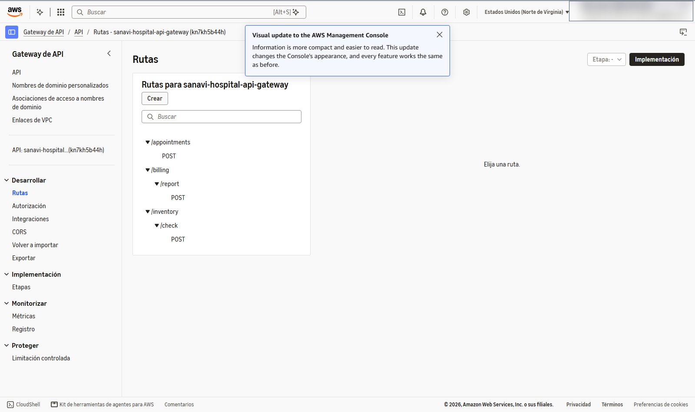
   
  <em>Anexo 12. Consola de Amazon API Gateway mostrando el árbol de rutas (POST /appointments, POST /billing/import y POST /inventory/check) de la puerta de enlace HTTP API sanavi-hospital-api-gateway (ID: kn7kh5b44h).</em>

### Anexo 13: Prueba en Vivo del Patrón Circuit Breaker (3x Errores 503 -> Estado OPEN) y Desvío Fallback a Cola SQS / DLQ
Finalmente, para comprobar empíricamente la tolerancia a fallos descrita en la Sección 3.3, se verificaron los parámetros del `ConfigMap` `sanavi-resilience-circuit-breaker-config` y los `PodDisruptionBudget` (`facturacion-service-pdb` y `hce-service-pdb`) en el clúster Kubernetes y se ejecutó la prueba de inyección de fallos contra el endpoint del sistema legado (`https://legacy-his.sanavi.internal/hl7/v2/adt`). Al provocarse **3 respuestas `HTTP 503 Service Unavailable` consecutivas** (`Attempt #1`, `Attempt #2` y `Attempt #3` con `timeout > 3000ms`), el disyuntor conmutó de inmediato del estado `CLOSED` al estado `OPEN` (`Cooldown Window: 30s | Fail-Fast Active`) y desvió automáticamente la transacción clínica HL7 (`ADT^A01` para `PAC-FICTICIO-001`) hacia la cola de respaldo **Amazon SQS (`sanavi-legacy-hl7-integration-queue`, `MessageId: 6f6579bc-ee87-4faf-b14d-10a518a4cd47`)** y hacia la cola **Dead-Letter Queue (`sanavi-legacy-hl7-dlq`, `MessageId: 1c7a2ae7-0556-4d8b-a423-dfd165d1b70f`)**, confirmando en los atributos de la cola (`ApproximateNumberOfMessages: 2`, `KmsMasterKeyId: alias/sanavi-hipaa-master-key`) la preservación íntegra y cifrada de los mensajes sin pérdida de información.

  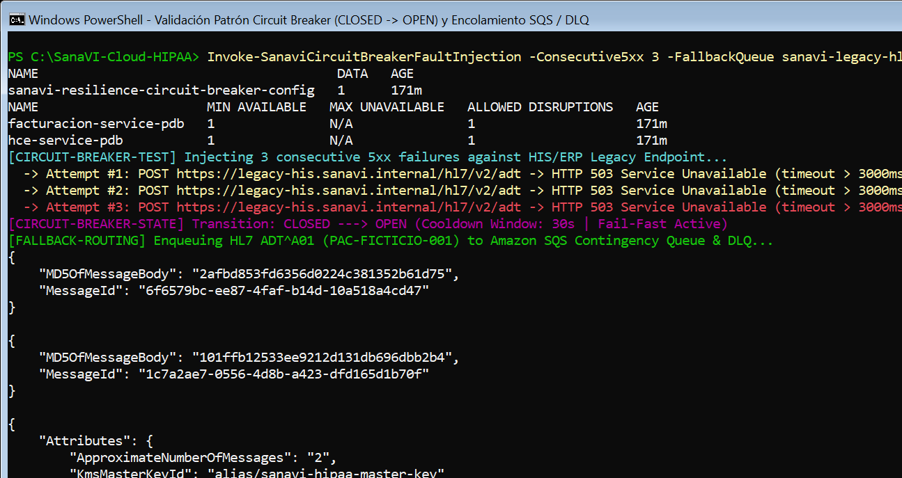
   
  <em>Anexo 13. Validación funcional del Patrón Circuit Breaker en Kubernetes y Amazon SQS: tras inyectar 3 respuestas HTTP 503 Service Unavailable consecutivas, el disyuntor pasa a estado OPEN (Fail-Fast) y desvía las transacciones HL7 hacia la cola SQS cifrada con KMS (MessageId: 6f6579bc-ee87-4faf-b14d-10a518a4cd47) y su Dead-Letter Queue sanavi-legacy-hl7-dlq (MessageId: 1c7a2ae7-0556-4d8b-a423-dfd165d1b70f), garantizando cero pérdida de datos clínicos.</em>

---

## 8. Conclusiones y Recomendaciones Estratégicas

1. **Eficiencia Comprobada del Modelo Híbrido (Kubernetes + Serverless):** La combinación de **Amazon EKS** (para los 5 microservicios de operación continua 24/7) y **AWS Lambda** (para los 3 procesos reactivos orientados a eventos) resuelve la fragmentación de los sistemas *legacy* del Grupo Hospitalario SanaVI. Tomando como base la Tabla 6.1, el escenario 100% Kubernetes cuesta un **58.1% más** que la arquitectura híbrida base (lo que representa un **36.7% de ahorro**, equivalente a **`$2,316.00 USD` anuales**), mientras que el escenario 100% Serverless cuesta un **23.5% más** que la arquitectura híbrida base (un **19.0% de ahorro**, equivalente a **`$936.00 USD` anuales**), eliminando simultáneamente los arranques en frío en la atención médica crítica.
2. **Cumplimiento Normativo HIPAA y HITECH de Extremo a Extremo:** El requisito de suscripción del contrato **BAA** en *AWS Artifact* para el entorno productivo, el uso de una clave maestra dedicada en **AWS KMS (`alias/sanavi-hipaa-master-key`)** para el cifrado en reposo en RDS PostgreSQL, DynamoDB, S3 y SQS, sumado al transporte sobre **TLS 1.3**, la autenticación **OAuth 2.0 / JWT** en Amazon Cognito con **MFA obligatorio** para personal médico/administrativo, el **diseño de producción para respaldo continuo (RDS Multi-AZ Backups + DynamoDB PITR**, validado funcionalmente sobre la instancia `db.t3.micro` single-AZ de laboratorio) y la arquitectura de auditoría en **CloudWatch Logs**, **AWS X-Ray** y **CloudTrail**, aseguran el cumplimiento integral de las normativas HIPAA y HITECH [1, 4].
3. **Resiliencia e Integración Segura con Sistemas Legados:** La incorporación del patrón *Anti-Corruption Layer* junto con colas **Amazon SQS (`sanavi-legacy-hl7-integration-queue`)**, **Dead-Letter Queues (`sanavi-legacy-hl7-dlq`)** y el patrón **Circuit Breaker** (validado en vivo en el Anexo 13 ante 3 fallos `HTTP 503 Service Unavailable` consecutivos) permite integrar gradualmente los sistemas hospitalarios antiguos sin arriesgar la estabilidad de los nuevos servicios en la nube [5, 6].

---

## 9. Referencias Bibliográficas

1. **Amazon Web Services (AWS)**, *Architecting for HIPAA Security and Compliance on Amazon Web Services*, AWS Whitepaper, 2024. Disponible en: https://docs.aws.amazon.com/pdfs/whitepapers/latest/architecting-hipaa-security-and-compliance-on-aws/architecting-hipaa-security-and-compliance-on-aws.pdf
2. **Amazon Web Services (AWS)**, *Amazon EKS Best Practices Guides: Security, Reliability, and Autoscaling*, AWS Documentation, 2025. Disponible en: https://aws.github.io/aws-eks-best-practices/
3. **Amazon Web Services (AWS)**, *Serverless Applications Lens — AWS Well-Architected Framework*, AWS Whitepaper, 2024. Disponible en: https://docs.aws.amazon.com/wellarchitected/latest/serverless-applications-lens/welcome.html
4. **U.S. Department of Health and Human Services (HHS)**, *HIPAA Administrative Simplification and HITECH Act Breach Notification Rule, 45 CFR Parts 160, 162, and 164*, 2024. Disponible en: https://www.hhs.gov/hipaa/for-professionals/security/index.html
5. **S. Newman**, *Building Microservices: Designing Fine-Grained Systems*, 2nd ed. Sebastopol, CA: O'Reilly Media, 2021.
6. **M. T. Nygard**, *Release It!: Design and Deploy Production-Ready Software (Circuit Breaker & Stability Patterns)*, 2nd ed. Raleigh, NC: Pragmatic Bookshelf, 2018.
7. **Amazon Web Services (AWS)**, *AWS Lambda Developer Guide: Lambda Quotas (15-minute maximum execution timeout and concurrency limits)*, AWS Documentation, 2025. Disponible en: https://docs.aws.amazon.com/lambda/latest/dg/gettingstarted-limits.html
8. **Amazon Web Services (AWS)**, *Amazon API Gateway Developer Guide: Choosing between HTTP APIs (v2) and REST APIs (v1)*, AWS Documentation, 2025. Disponible en: https://docs.aws.amazon.com/apigateway/latest/developerguide/http-api-vs-rest.html
9. **Amazon Web Services (AWS)**, *AWS Pricing Calculator & Official Service Pricing (Amazon EKS, Amazon RDS for PostgreSQL, Amazon DynamoDB On-Demand & PITR, Amazon Cognito MAU Tiers, AWS NAT Gateway, and Amazon API Gateway v2 in us-east-1)*, 2025. Disponible en: https://calculator.aws/
